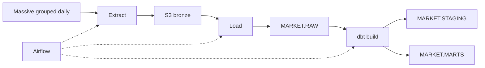
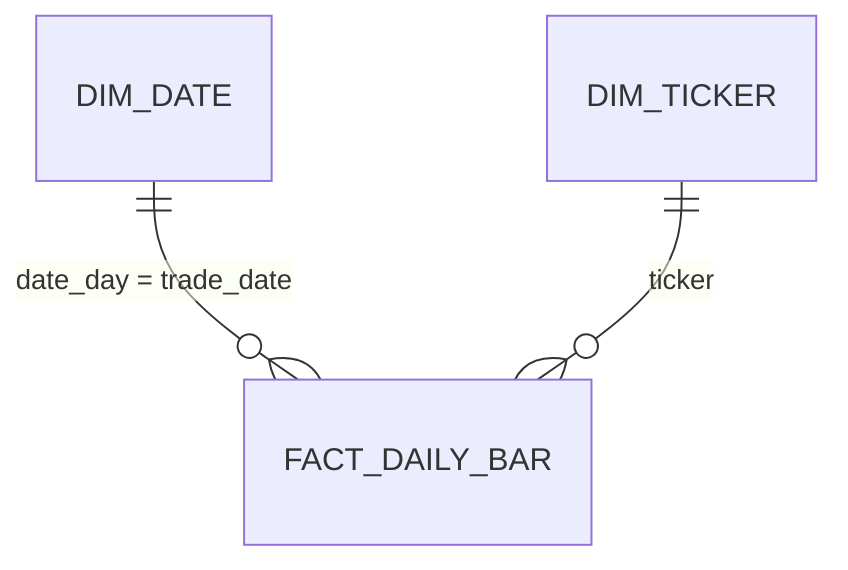

# US Equity Daily Bars

Daily US equity bars in a medallion warehouse. One grouped request to the Massive API (formerly Polygon) returns every US listed stock for a session. The extract writes that payload to S3 as Parquet plus a manifest. Snowflake `MARKET.RAW` is the loaded copy. dbt rebuilds silver in `MARKET.STAGING` and a star schema in `MARKET.MARTS` from RAW. Airflow runs extract, then load, then `dbt build`.

The grain is one row per ticker per trade date. Prices are unadjusted. OTC names are excluded. The natural key is the ticker plus the trade date. S3 keeps the vendor payload, and each dbt build reapplies the current marts definition to all of RAW. A load replaces one market date and leaves the others in place.

## Architecture



| Layer | Object | Grain |
| --- | --- | --- |
| Bronze | `bronze/daily_bars/trade_date=YYYY-MM-DD/bars.parquet` | One file per market date. Rows are the vendor bars |
| Bronze | `bronze/daily_bars/trade_date=YYYY-MM-DD/manifest.json` | One manifest per market date |
| RAW | `MARKET.RAW.DAILY_BARS` | One row per ticker per trade date in that file |
| RAW | `MARKET.RAW.DAILY_BARS_LOADS` | One row per loaded market date, including closed days |
| Staging | `MARKET.STAGING.STG_DAILY_BARS` | One clean row per ticker per trade date |
| Staging | `MARKET.STAGING.STG_DAILY_BARS_QUARANTINE` | One rejected RAW row |
| Marts | `MARKET.MARTS.DIM_DATE` | One calendar day from the first loaded session through the last |
| Marts | `MARKET.MARTS.DIM_TICKER` | One ticker seen in clean bars |
| Marts | `MARKET.MARTS.FACT_DAILY_BAR` | One clean bar per ticker per trade date |

The extract writes S3 with its own credentials. Snowflake reads that prefix through a storage integration on a separate read-only role.

## Source

```text
GET https://api.massive.com/v2/aggs/grouped/locale/us/market/stocks/{date}
```

The parameters are `adjusted=false` and `include_otc=false`. Massive split-adjusts unless `adjusted` is false, and a later split would change values already archived. The manifest stores the same pair, and the loader rejects a file that does not match.

| Key | Meaning | Parquet type |
| --- | --- | --- |
| `T` | Ticker | string |
| `o`, `h`, `l`, `c` | Open, high, low, close | float |
| `v` | Share volume | float |
| `vw` | Volume-weighted average price | float |
| `t` | Bar timestamp, epoch milliseconds | int |
| `n` | Transaction count | int |

These nine columns are always on the file. Extra keys the API sends stay in the Parquet object and are not RAW columns. `trade_date` is not in the file. The partition is the date requested, and the loader sets `trade_date` from `t`. That timestamp is the 16:00 New York close, which falls on the session date in UTC, so the expression is `TO_DATE(TO_TIMESTAMP_NTZ("t", 3))`. Every copied row must fall on the requested date.

## Bronze

Each market date is one prefix, `bronze/daily_bars/trade_date=YYYY-MM-DD/`, with `bars.parquet` and `manifest.json`. The manifest records `trade_date`, `row_count`, `extracted_at`, `request_id`, `api_status`, and `request_params`. It is written after the Parquet file and is the commit marker. A Parquet object newer than the manifest means a re-extract is in progress, and the loader refuses it.

A closed day (not an XNYS session) is a zero-row file with `row_count` 0. A date the job never ran has no partition. Zero rows on an XNYS session mean the vendor has not published yet: the extract uploads nothing, and a previous partition stays. A successful re-run overwrites that partition.

## RAW

`DAILY_BARS` keeps the vendor names as quoted identifiers. The copy matches columns case-sensitively so `T` and `t` stay distinct.

| Column | Type | Meaning |
| --- | --- | --- |
| `"T"` | VARCHAR | Ticker |
| `"o"`, `"h"`, `"l"`, `"c"`, `"v"`, `"vw"` | FLOAT | Open, high, low, close, volume, VWAP |
| `"t"` | NUMBER | Bar timestamp, epoch milliseconds |
| `"n"` | NUMBER | Transaction count |
| `trade_date` | DATE | Session date, set from `t` after the copy. Nullable so the copy can insert it as null |
| `extracted_at` | TIMESTAMP_NTZ | Parquet object's S3 last-modified time, UTC |

`DAILY_BARS_LOADS` holds one row per loaded date, including a closed day with `row_count` 0. A reload updates the row for that date.

| Column | Type | Meaning |
| --- | --- | --- |
| `trade_date` | DATE | Loaded market date |
| `row_count` | NUMBER | Rows copied. `0` on a closed day |
| `extracted_at` | TIMESTAMP_NTZ | Manifest clock, UTC, taken before either upload |
| `request_id` | VARCHAR | API request id when the payload includes one |
| `api_status` | VARCHAR | Status on the manifest |
| `loaded_at` | TIMESTAMP_NTZ | When this audit row was written |

The two `extracted_at` columns are different clocks. Freshness reads the audit clock and warns after three days. A closed day writes an audit row and no bar rows, so the bar table's clock does not move.

One transaction deletes that `trade_date`, copies the file, sets `trade_date`, and merges the audit row. `FORCE = TRUE` makes the copy reload a file Snowflake has already loaded. If the loaded count does not match the manifest, the transaction rolls back and the previous rows remain.

## Staging

Silver renames the vendor columns and casts them. It does not dedupe. The load already leaves one landing per date, and a uniqueness test on `(ticker, trade_date)` fails a duplicate.

Every RAW row lands in exactly one table. `STG_DAILY_BARS` keeps a row when ticker, open, high, low, close, and volume are present, high is at least low, and volume is at least zero. `STG_DAILY_BARS_QUARANTINE` keeps the rest: a null in any of those fields, high below low, or volume below zero. Nulls are listed on the quarantine side, so a comparison that is unknown cannot drop the row from both. VWAP, transaction count, and the epoch timestamp are not part of the rule. Quarantine does not feed the marts.

| Staging column | Source | Type |
| --- | --- | --- |
| `ticker` | `"T"` | varchar |
| `open`, `high`, `low`, `close`, `volume`, `vwap` | `"o"`, `"h"`, `"l"`, `"c"`, `"v"`, `"vw"` | float |
| `window_start_epoch_ms` | `"t"` | number |
| `transactions` | `"n"` | number |
| `trade_date` | Loader column | date |
| `extracted_at` | Parquet S3 last-modified, UTC | timestamp |

## Marts

Gold is a star on natural keys. There are no surrogate keys. `FACT_DAILY_BAR.ticker` references `DIM_TICKER.ticker`, and `FACT_DAILY_BAR.trade_date` references `DIM_DATE.date_day`. The fact contains clean sessions only.



Derived columns are the session itself, or a comparison with that ticker's previous clean bar. Multi-day windows stay in the query. `window_start_epoch_ms` stays in staging. The session is `trade_date`.

### `DIM_DATE`

One row per calendar day from the earliest clean `trade_date` through the latest, inclusive. Days outside that span are absent.

| Column | Meaning |
| --- | --- |
| `date_day` | Calendar date. Grain, unique |
| `is_weekend` | Saturday or Sunday |
| `is_holiday` | Weekday with no rows in `STG_DAILY_BARS` |

`is_holiday` follows the bars, not an exchange calendar. An exchange holiday matches it. So does a weekday inside the spine that produced no clean rows. A weekend is `is_weekend` only.

### `DIM_TICKER`

One row per ticker in clean bars. A symbol that only failed quarantine is absent.

| Column | Meaning |
| --- | --- |
| `ticker` | Symbol. Unique |
| `first_trade_date` | Earliest clean `trade_date` for this ticker |
| `last_trade_date` | Latest clean `trade_date` for this ticker |

Those dates are the span present in the loaded history. There is no company name, exchange, or active flag.

### `FACT_DAILY_BAR`

One row per ticker per trade date from `STG_DAILY_BARS`. Bar columns pass through. `extracted_at` is the Parquet clock from silver.

| Column | Meaning |
| --- | --- |
| `ticker` | Symbol. Foreign key to `DIM_TICKER` |
| `trade_date` | Session date. Foreign key to `DIM_DATE` |
| `open`, `high`, `low`, `close` | Unadjusted prices |
| `volume` | Share volume |
| `vwap` | Volume-weighted average price. May be null |
| `transactions` | Transaction count. May be null |
| `extracted_at` | Parquet S3 last-modified, UTC |

`prior_close` is `lag(close)` for that ticker, ordered by `trade_date`, over clean bars. A missing session uses the previous clean bar, which can be more than one calendar day earlier. It is null on a ticker's first clean bar in the loaded history. Close-to-close fields use that value, on the unadjusted series.

Ratio columns are fractions. `0.05` is a five percent move.

| Column | Definition | Null when |
| --- | --- | --- |
| `dollar_volume` | `close * volume` | |
| `range` | `high - low` | |
| `gap_pct` | `(open - prior_close) / prior_close` | No prior clean bar, or prior close is 0 |
| `pct_gain_loss` | `(close - prior_close) / prior_close` | No prior clean bar, or prior close is 0 |
| `dollar_change` | `close - prior_close` | No prior clean bar |
| `pct_from_open` | `(close - open) / open` | Open is 0 |
| `dollar_change_from_open` | `close - open` | |
| `pct_open_to_high` | `(high - open) / open` | Open is 0 |
| `pct_open_to_low` | `(low - open) / open` | Open is 0 |

A zero open still produces `dollar_change_from_open`. A zero prior close still produces `dollar_change`.

## Orchestration

`daily_market_bars` runs at 06:00 America/New_York, Tuesday through Saturday, and loads the previous New York calendar date. A run can pass a date explicitly. Airflow `logical_date` is not the market date. A weekday holiday still runs and lands an empty partition. `backfill_market_bars` walks an inclusive calendar range one date at a time, then runs `dbt build` once.

## Scope

The daily path is built: extract, the RAW load, staging, the marts, the daily run, and backfill.

Later work is hosted orchestration, reference data, splits, dividends, adjusted and total-return series, minute bars, trades, quotes, and websockets.
